# How to Create Creature Sprites for Use in Forge Adventure Mode

by Hesitant_Weevil

So, would you like to see a particular creature show up among the enemies or selectable player character sprites in Forge Adventure Mode? Perhaps a generic looking creature sprite of a certain creature type, or perhaps a unique sprite that looks just like that cool Legend from your favorite commander deck?

Here is a how-to guide based on my own experiences making creature sprites for the Fallen Empires quests in Shandalar Old Border Adventure Mode.  
 Caveat: This tutorial is made by someone who has no formal background in graphic design or animation. I only started experimenting with sprites and pixel art a handful of months ago and am still learning as I go along. This guide is just meant as a fairly detailed starting point to help you get going with your own creative experiments.

### **Creature Sprites 101**

Creature sprites are the small pixelated images inside the game that make all characters look the way they do and move the way they do. You see creature sprites all the time when you move around in the Adventure Mode world, both in the form of your own player character and as all enemies and neutral npcs you encounter. These images are very low in resolution and are sometimes referred to as 'pixel art'.  
The game displays a series of such sprite images with small differences between each that make it seem like the characters are walking, flying, attacking, dying, etc. - just like in traditional cartoon animations. All of these images are saved in so-called 'sprite sheets', one for each creature.

If you haven't done so already, take a moment to check out some of those sprite sheets that are already included in your current Forge game installation. You can find them in the \\...\\res\\adventure\\common\\sprites folder (the "\\...\\" refers to the name of the main folder location in which you've installed Forge. Those things vary between users and devices).  
You'll notice that for each named creature there's both a .png format sprite sheet and a so-called '.atlas' file. The atlas file tells the game how to interpret and display all the pictures on the sprite sheet. More on that later.

### **Software**

Now, to make creature sprites you'll need some software.  
If you're just making a recolored version of an existing sprite sheet, you won't need anything more than a basic image editing program. For small edits to other parts of an existing sprite sheet, this might be okay as well. But it quickly gets cumbersome the more changes you want to make. For heavy edits to existing sprite sheets and for the creation of entirely new sprites, you'll need software with functions better suited for the task.

The software I'll be referring to in this guide is Aseprite (<https://aseprite.org/> ), but several other similar programs exist. Some are commercial while others are freeware. Aseprite comes either as a one-time paid version, or as a free version that you'll, however, first need to compile yourself. I went for the paid version, because coding is not my thing, because I like to support independent developers, and because the price was very fair.

If you're completely new to pixel art and animation I recommend that you first start out by watching one or two basic tutorials on YouTube. This is just for you to get a feel for some of the different tools and functions of Aseprite or other pixel animation programs. There are some excellent artists and teachers out there that explain things much better than what can be done in this document.

This tutorial skips ahead of all that to focus on how to create and edit MtG related creature sprites for use specifically in Forge Adventure Mode.

**This tutorial is split into 4 sections:**

1. How to make a recolored version of an existing creature's sprite sheet. (very easy)
2. How to make a new creature sprite by editing a copy of an existing sprite sheet. (easy to medium difficulty)
3. How to make an entirely new creature sprite based on an MtG card image. (medium to hard difficulty)
4. How to make your new creature sprites show up in the game.

## **Section 1: How to Make a Recolored Version of an Existing Creature Sprite**

Very straight forward: Find the sprite sheet you want inside your local game installation folder (\\...\\res\\adventure\\common\\sprites). Make a copy of it and of the .atlas of the same name next to it.  
Open the sprite sheet .png file in an image editing program.

Two approaches:

1. Use the 'Magic Wand' tool to mark the color you want to change. If your software has such an option, first toggle off the 'contiguous' setting for the Magic Wand tool. With this off, click on a spot anywhere on the sprite sheet that contains the color you want to change. The Magic Wand tool will now mark all areas of this color on the entire sprite sheet. With those areas marked, select the Color Fill tool and likewise toggle off the 'contiguous' setting for that one. Select the new color you want and click on one of the selected areas. Voilà! All areas with the old color have now been replaced with the new color you chose.

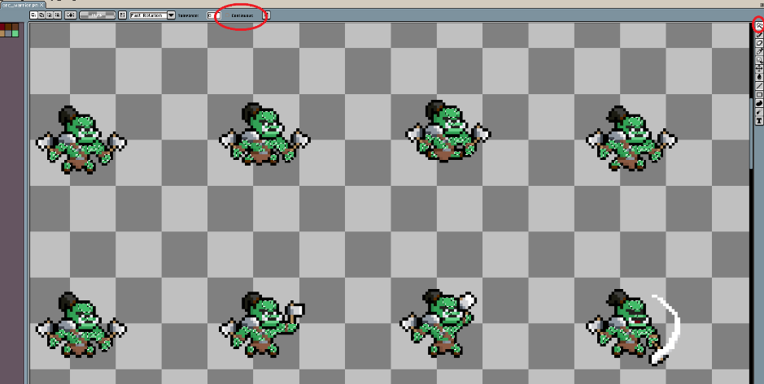

Here's an example taken from the Aseprite image editor. I've circled the mentioned Magic Wand Tool settings. You can see that all instances of one color on the Orc sprite sheet have been selected at the same time.

2. If the quick method above isn't an option in your image editing software, you'll unfortunately need to use the Color Fill tool to change each spot one click at a time. Much more tedious but still doable.

Repeat the procedure until you've replaced all the colors you want.

  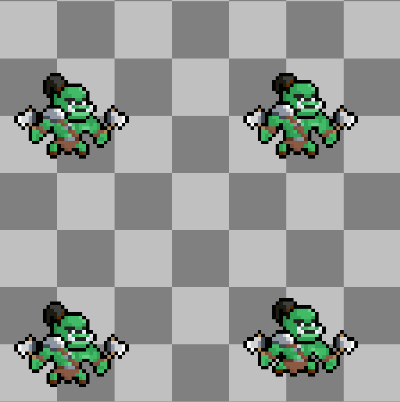
  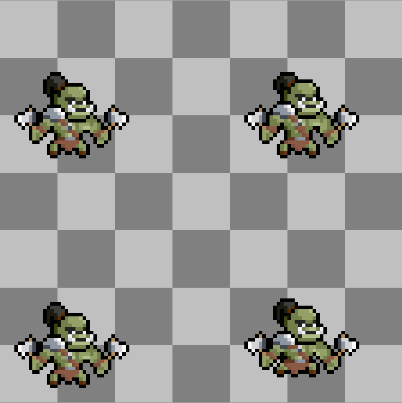

Example: original 'orc_warrior' on the left, recolored version on the right.

Then, when you're done recoloring, save the sprite sheet under a new name and exit.

Next, rename the copy of the accompanying .atlas file so that it matches the name of your new sprite sheet. Then, use a simple text editing program like Notepad to open the .atlas file. Inside the file you'll see some lines of text and below that lots of numbers. Ignore everything below the top line. Rename the creature listed there so that it now matches the name of your recolored sprite sheet. Then save and exit.

That's it - you're done!

**Note:** If you're recoloring a player character type sprite sheet instead of that of an enemy creature, remember that all player characters' avatar portraits are stored in a separate combined 'avatar' sprite sheet in the 'heroes' subfolder. This is different from the sprite sheets of enemies that each have their individual avatar portrait integrated into it.  
So, while the sprite sheet recoloring process is basically the same for player character sprites as for enemies, for the 'heroes' you just need to remember to also recolor the avatar portrait on their separate avatar sprite sheet.

_For ways to make your newly recolored creature sprites show up inside your own Adventure Mode games, check out the final section of this tutorial._

## **Section 2: How to Make a New Creature Sprite Based on an Existing One**

To do this, first find a suitable sprite sheet among those in your Adventure Mode game installation folder. Look for the one that most closely matches what you want your own creature sprite to look like as well as how you want it to move. This is of course just to prevent you from doing more work than what's necessary.

Make a copy of the chosen sprite sheet along with its accompanying .atlas file.

For tiny changes to the original, you can simply open the copied sprite sheet in your regular image editing program. There you can edit the pixels you want on each of the creature images across the sprite sheet.

For larger changes I recommend you use a more specialized pixel editing tool. In such software you can quickly make more complicated edits to the images and conveniently test along the way how your changes look when played as an animation.

Alright. Now we're about to do some image editing that's a bit more involved than just a matter of recoloring.

Let's first take a closer look at a couple of sprite sheets already used in Adventure Mode:

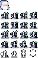

This is the sprite sheet for a standard human wizard. Each individual sprite image on the sheet measures only 16x16 pixels. This is the smallest sprite size currently used in Adventure Mode. Most creatures in the game are of this size, while a few are larger - typically 32x32 pixels.

Here is an example of an existing sprite sheet with images at 32x32 pixels each:

Quite a difference. When making new creature sprites based on existing ones you'll mostly be working at one of these two resolutions, since these are most common.

The 16x16 sprites can be edited very quickly, but the looks and movements can be difficult to get right at this minimal scale. The 32x32 sprites tend to take more time to edit because of the larger pixel count, but it'll be easier to express your creature's looks and movements the way you want.

**Note:** Adventure Mode supports creature sprites consisting of up to 128x128 pixels each, even though the game's standard creature sprite folder doesn't currently include any. For new sprite creation at scales up to 128x128, check out Section 3 of this tutorial.

Now let's break down the contents and functions of one of these sprite sheets.  
Here is the standard human wizard again, now with some explanations added:

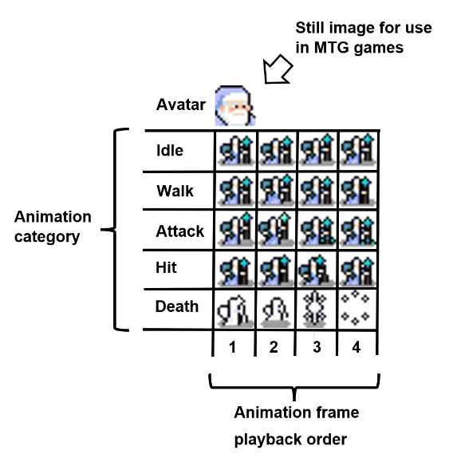

The 16x16 pixel avatar is the portrait that shows on the screen when you battle this enemy in an MtG game. Note that on the larger 32x32 dwarf sprite sheet above no separate avatar image is shown. This is because the creature sprite itself is large enough that the game can use a snapshot of the face part of one of the animation category images as the avatar instead. Here in the example of the human wizard, the tiny animation sprites result in the need for a separate avatar portrait.

Each of the five rows below the avatar contains four images that add together to form a small animation sequence. Idle and Walk animations are the ones most frequently seen inside the game, since these play on loop whenever the creature moves around or stands idle on the overworld, dungeon, or cave type maps.

Attack, Hit, and Death each play only once when the right condition is met. Attack plays when a player's character sprite collides with an enemy sprite and an MtG match is about to begin. Death plays when the player has defeated the enemy and the screen has just switched back from the Forge MtG game screen to the Adventure Mode graphic view. Hit plays whenever a player's character sprite touches an npc sprite without starting a battle. However, this Hit category rarely triggers since most Adventure Mode creatures count as enemies, in which case the Attack sprite plays instead.

If you like to save some time, you can simply omit the Hit category from your custom sprite sheet. The game will read the rest of the sprite sheet fine without it.

To edit a copy of an existing sprite sheet I recommend you do the following:

1. Open the sprite sheet .png in Aseprite or a similar program.
2. Create a new .png file with a canvas height and width that matches the total canvas size of the original 16x16 or 32x32 sprite sheet.
3. On the new sheet, create a new empty layer for each animation category and name each accordingly.
4. Add a number of animation frames so that it matches the number used on the original sheet (typically 4-8).
5. Copy each individual image from the sprite sheet onto the corresponding layer and frame on your new sprite file.
6. Within each animation category, move the images on each frame to the same leftmost position on the canvas. By overlapping sequential images this way you can quickly test the look of the animation by using the left/right arrow keys on the keyboard to go back and forth between frames while you edit.
7. Proceed to edit each image the way you want.

Here is how such a setup might look:

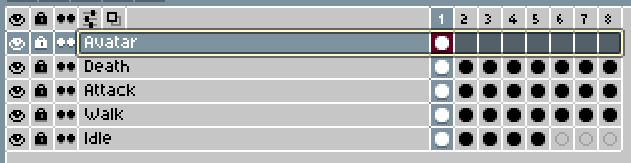

What I typically do is to make all the changes I want to the very first sprite in the Idle category. Then after that I copy those changes over to all the other sprite images, adjusting each so that it matches the existing movements and actions of those.

A trick I use to make this process easier is to temporarily place a second copy of the same frame of the original sprite image next to the one I'll be editing. This way I can quickly reference the old one while making the new version.

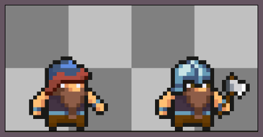

New on the left, original on the right.

When you are done with your edits, copy each image onto a new empty canvas arranged in the same order as on the original sprite sheet. When you do this, make sure to maintain the exact same spacing between the images. Then save your new sprite sheet as a png file.

Finally, edit the name of the copy of the original sprite sheet's accompanying .atlas file so that it now matches that of your new png. Also, open the atlas file with a simple text editor like Notepad and change the first line of text inside so that the name there likewise matches that of your new sprite sheet. As long as you haven't changed the size of the overall sprite sheet, of individual sprites (for instance by adding a new larger weapon), or added/omitted any animation categories or frames, then you should be fine. Otherwise, check towards the end of the section below for more info on how to adjust the categories and coordinates of .atlas files.

That's it - your custom sprite is now ready for use!

_Check out the final section of this tutorial for ways to make your newly created creature sprites show up inside your own Adventure Mode games._

**Note on player character ('hero') sprites:** The approach above covers the editing process for enemy creature sprites. If you've looked inside the 'heroes' sprite folder you've likely noticed that those sprite sheets, while similar, include a lot more images than the enemy sprite sheets do. This is because each player character sprite can face in eight directions (up, down, left, right + angled up right, up left, down right, down left) which results in smoother movement animations. Also, you've likely noticed that all player character avatar portraits are stored in a separate combined 'avatar' sprite sheet, instead of as part of each individual character's sprite sheet.  
So, the sprite sheet editing process is principally the same for hero characters as for enemies, although more time-consuming for heroes due to the higher number of sprites. You do also need to edit the look of the hero character's avatar portrait on the separate avatar sprite sheet in the 'heroes' subfolder.

To close out this tutorial section, here are a couple of examples of new sprites I've made based on existing ones:

  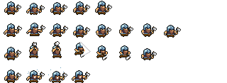
  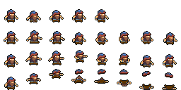

On the left: the 'dwarflarge' sprite sheet currently included in Forge. On the right: a new 'dwarven_trader' sprite sheet based on it. I also made a brand-new death animation sequence on the bottom row, since I didn't quite like the original one (the four images on the bottom of the original sheet).  

  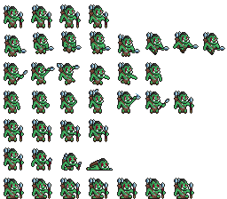
  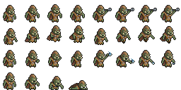

On the left: the existing 'orc_hunter' sprite sheet included in Forge. On the right: a new 'orcish_spy' sprite sheet based on it.

As you can see, I made a lot of changes to this one. The Orc Hunter sprite sheet also includes a bunch of animations that are not currently usable by the Adventure Mode game engine. Likely because that sprite sheet has been adopted from another open source sprite project elsewhere. So, for the Orcish Spy I reduced the number of images to just include the four primary animation categories used in Adventure Mode: Idle, Walk, Attack, and Death.

For more information on these (and other) categories, see the advanced sprite creation section below.

## **Section 3: How to Make a New Creature Sprite based on an Existing MtG Card Image** ##

### **3.1 Select Your Reference Material** ###

First of all, for this you'll need some reference material to base your sprite on. Let's say you want to base it on the illustration from one of your favorite MtG creature cards. In this case, go to a place like Scryfall.com and save a copy of the card image.

In this example I'll use the Orgg creature card.

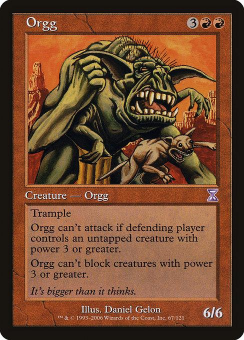

### **3.2 Isolate the Creature Part of the Image** ###

First, open your selected image in Aseprite and save it as an .ase project file.  
Now it's time to convert your reference image into a simplified version that can serve as a base when you create your pixel art.

1. In the gray box at the bottom of the screen, check which image property it currently states. If it says Layer, you're good to go onto the next step. If it says 'Background', then right click on it and select the option to convert background to layer.

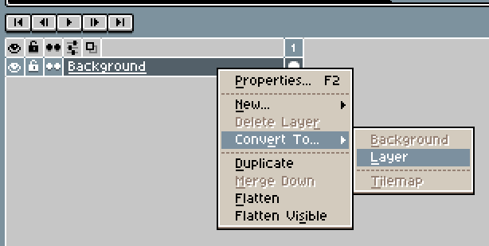

2. Use the polygonal lasso tool (shift-q) and the eraser tool (e) to delete the background and other unneeded parts of the picture, leaving only the creature itself. Try to cut reasonably close to the outline of the creature, but don't obsess over precision. The main thing is to remove all background colors that don't repeat on the creature itself, since we won't need those in the color palette we're about to build.

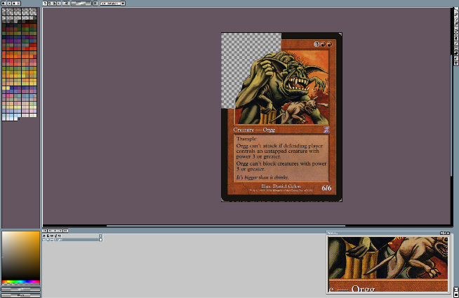

**3.3 Build the Color Palette**

With all the unneeded image parts removed, go to the Sprite Menu in the top toolbar, look under Color Mode, and select Indexed.

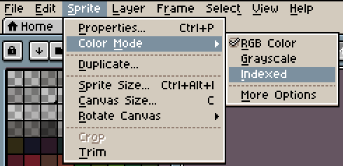

Then click on the button with three horizontal lines at the top of your color palette on the left side of the window. There, select New Palette from Sprite.

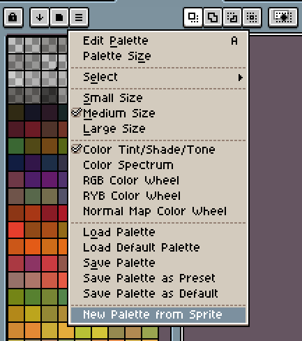

A prompt will then ask you to select the number of colors. You can choose any number you like, but I usually go for something like 16. This is most often enough to cover what you need for a good-looking creature sprite in the game. We'll soon be working at a small scale with a very limited pixel count, so there won't be much room for lots of color nuances and gradual fades from one color to another. Also, with too many colors on your palette you'll easily get frustrated trying to pick the best one.

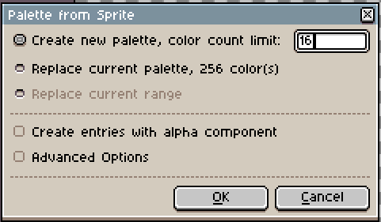  
**Note:** Once you click OK to this prompt, your image will disappear from view. But don't worry, the very next step will bring it back.

At the bottom of your now much smaller color palette on the left side of the window, you should see this button:

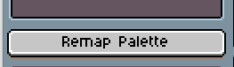

Press it, and your image will reappear. Now recolored according to the much smaller palette size you chose. This will make the next stages of the drawing process much easier.  
You can always add more colors to your palette later on, if you decide that your sprite needs it.

At this point your image might look something like this:

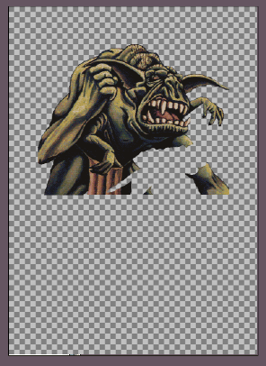  
Simplified colors and lots of empty space from the deleted background and foreground parts of the illustration, as well as from the removal of the entire card frame and text box.

### **3.4 Scale Down the Image Resolution** ###

Now that the color palette has been prepared, it's time to adjust the size of the canvas and of the sprite you'll be making.

Forge Adventure Mode currently supports creature sprite sizes no larger than 128x128 pixels (true as of late 2026 - might be adjusted upwards in the future). But most creature sprites you encounter in the game are much smaller; typically between 16x16 and 32x32. Each size comes with advantages and disadvantages:

- The smaller you make your creature sprite the simpler it will be to edit in terms of total number of pixels. But at the same time, the smaller you go the harder it becomes to include details from your source image, such as facial features, clothing, or special items.
- The larger you make your creature sprite, the more work you'll need to do in terms of both initial pixel drawing and later adjustments when it becomes time for animation. But a larger size allows you to include much more detail.

Usually, I try to aim for 64x64 pixels when making human sized creature sprites inspired by real card illustrations. Lower than this and I struggle to include enough detail to make the creature uniquely recognizable inside the game.  
For giant sized creatures or creatures with particularly tricky image details, I'll go for a larger resolution up to the 128 pixel limit.  
 You don't need to decide on the exact size of your creature sprite right now. The following process will help you figure out just how low you can make the resolution of your chosen creature sprite before too much detail is lost.

**Note:** sprite display sizes can later be scaled both up and down inside the game, so don't get too hung up on picking a size that matches the exact size you think your creature should have relative to others.

What you need to do now is to go to the Sprite category in the top menu and select Canvas Size.

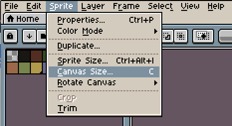

There you'll see that your canvas right now is probably quite large - and depending on your source image - might showcase the exact proportions of a Magic card.

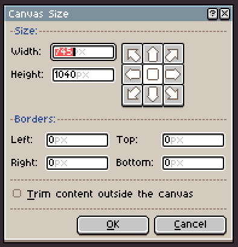

Right now, don't worry about resolution. We'll get to that in a second. What's important is that you take a look at your image and try to get a feel for the dimensions of any extra space you want to reserve around it. Should it move in a particular way - for instance fly with the use of unfolded wings? Should it attack in a way that reaches out far - for instance with long claws or a spear?

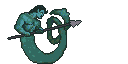

You can also adjust these dimensions later. Just be aware that if you from the onset decide to work at close to the maximally supported 128x128 pixel size, then you might face problems later if you want more space for your creature's movements.  
For now, center your illustration as you prefer and adjust the canvas to give it the approximate dimensions you want. Don't worry about pixel resolution right now. Confirm and exit the menu prompt.

Next, move on to click the Sprite Size option in the same Sprite top menu as before. Here we get to one of the crucial parts: the time has come to scale down the resolution of your reference image to match the size of the sprite you'll be creating.

Try and do the downscaling gradually in a number of steps, for instance by taking it down to 512x512 pixels. Then 256x256. Then 128x128. Then 64x64 or lower again. Each step reduces the image resolution, so check along the way how much detail gets lost. Some creature images can remain easily recognizable at quite low resolutions, while others need to stay larger. Again, no matter what, you need to eventually get to 128x128 pixels or below for the finished sprite to work inside Adventure Mode.

Here is what the isolated Orgg image looks like when reduced to 128x128 pixels. I decided to stop here, since I wanted the Orgg sprite to appear very large and detailed inside the game. After all, it is a 6/6 creature with a flavor text that says "It's bigger than it thinks." Also, since I decided to make it an enemy boss fight in one of the Fallen Empires quests I worked on, I wanted to signal to the players that this creature was a bigger deal than the others they'd encounter nearby.

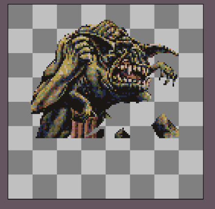

Already here I've made the choice to emphasize body size over movement. Each square in the background represents 16x16 pixels, so this canvas is already at the maximum size currently allowed in Adventure Mode. Consequently, all walk, attack, and death animations will now need to fit within this canvas space.  
If I had started lower than 128, I would have retained more flexibility to extend the canvas later, if I decided to add more wide-ranging movements of arms and legs.

So far, so good. Now you should have a rough pixelated version of your source image that will serve as a template for the actual sprite you're about to draw.

### **3.5 Draw some Pixels** ###  
At this point we're ready to create the initial pixel art sprite that will serve as the starting point for the later animations.

Here, I recommend that you start out by creating a new layer that goes on top of the current one you've been working on so far. This ensures that you keep the original image intact and handy as a reference as you go along.

Double-click on the Layer line in the window below your image and rename it to something like 'Base' so you can tell it apart. Then, right click that same line and select New Layer.

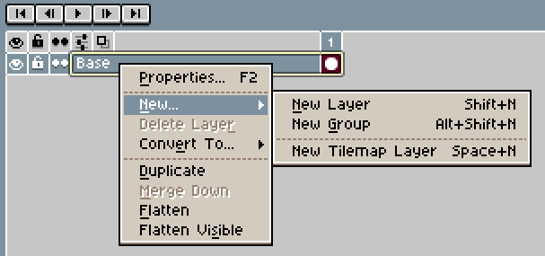

Your setup should now look something like this:

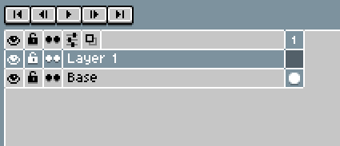

The new layer is so far empty and placed on top of our base image. This allows us to draw on it and create a fresh version by retracing the outline and by repeating the color and position of each pixel that we want to keep. It also gives us a place to sketch in the parts of the creature that may be missing from the original image.  
By toggling the 'eye' icons on the left side on and off, you can quickly check your progress as you go along.

Note: Be very careful to make sure that you always have the correct layer active when you're editing the image, or else things will soon get messy and confusing. You can help ensure this by pressing the padlock icon on the Base layer. This prevents further changes to that layer.

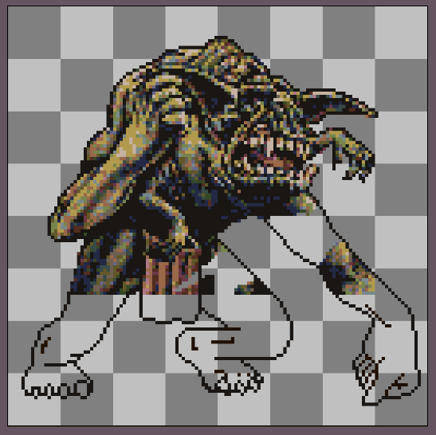

Here I've tried to sketch in the Orgg's missing legs and the arm as I imagine they might look. For the legs with clawed feet, I found inspiration by looking at the Starter 99 / Starter 2000 version of the Trained Orgg card, so far the only such published Orgg creature card with the feet showing on the illustration. I then did a freehand sketch on Layer 1 with the Aseprite pencil tool set to the size of 1 pixel. After the first rough sketch, I did a few more passes to adjust and erase unneeded pixels from the sketch until it finally looked like it does above.

For the missing arm and fist, I first looked at the other arm and fist of the Orgg illustration and tried to imagine how it might be positioned. With an idea in mind, I then took a photo of my own stretched arm and clenched fist atop my work-desk. I used that photo as a visual reference while sketching in that missing part. It's not a perfect match, but it worked for a start (Later though, I went back and changed the pose of the arm and fist into something more suited for the animations I decided to do. That can easily happen - the initial pose on the MtG illustration may not match the pose and motions you want your creature sprite to have and make).

After making the first outline sketch I proceeded to draw the entire creature sprite image on the new top layer, pixel by pixel. I did so by repeating the pixel positions and colors I liked from the reference image below and by skipping the others. Where I didn't have reference information I just filled out the empty spaces as I imagined they might look. With enough areas filled in, I switched off the reference base layer entirely and added the remaining pixels with colors picked to best match the other pixels nearby.

Here is the finished result of that process:

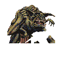

For a 128x128 sprite image, this process can take quite a long time and cause you some frustrations along the way. So, I recommend that you at least for your first projects try to stay at a lower resolution, ideally around 64x64 pixels or even less. The 64x64 should be big enough for many MtG card based creature sprites to look recognizable while still small enough to draw and edit without getting overwhelmed.

Here are two examples of smaller MtG based sprites I've made, shown next to the downscaled reference image I used for each of them:

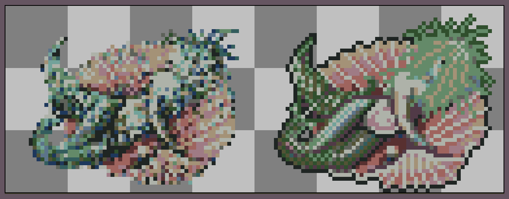

Seasinger sprite at 64x48 pixels.

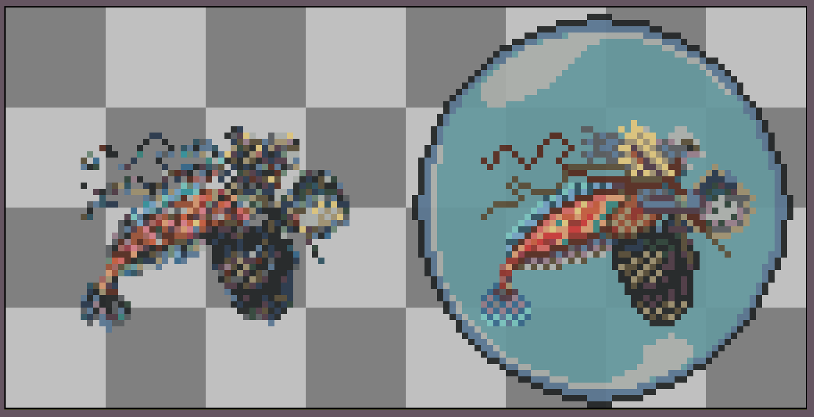

Svyelunite Priest sprite at 64x64 pixels. I added a bubble to the finished sprite, because I couldn't figure out how this very fish-like creature could otherwise make sense moving around on the dry land areas of Adventure Mode (let's not talk about Adventure Mode and merfolk in general 😅).

As you can see, in both of these examples the reference images were very pixelated and crude. But that's alright since they're mostly just used to ensure that you get the body proportions and colors true to the original. Keep a copy of the original hi-res card image handy in a separate window while drawing the sprite. This way you can easily check and make creative decisions along the way when in doubt.

Again, what we're doing here are not really attempts to make perfect copies of the original images, but to create new low-res pixel art sprites that recognizably reference and pay tribute to the original cards.

One important technical detail to check before we proceed:

The game engine of Forge Adventure Mode presumes that all enemy creature sprites face to the right on their sprite sheet. This means that inside the game it will display each sprite as-is when the creature is moving towards the right side of the screen, whereas it will flip it around horizontally when the creature is moving towards the left.  
If your creature sprite at this point happens to face left, now is the best time to flip it around. An option in the Aseprite Edit menu allows you to do that. If you don't do this, your creature will simply face backward when walking forward inside the game.

### **3.6 Animation Types and Timings** ###

Now that we have a complete pixel art still image of our creature it's time for animation.

For this step, we first need an overview over the types of animations needed and how all such things work in Adventure Mode.

In Adventure Mode there are currently 4 main types of animations that your creature sprite can display.\* These are: _Idle, Walk, Attack, and Death_.

Ideally, you'd want to make an animation sequence for each of those. Animation matters the most for the _Walk_ animation and the _Idle_ animation, because those two will be looping repeatedly inside the game from the moment the creature appears on screen and until players interact with it. _Attack_ and _Death_ animations are more of "blink-and-you'll-miss-it" one-time displays, so while cool to have, their absence is less noticeable.

\*Adventure Mode also supports the additional animation categories called _Hit, Hidden,_ and _Wake_. But these are rarely used, and depending on what creature you've chosen you may want to skip them.  
_Hit_ defines an animation that plays when a player's character sprite bumps into the creature's sprite. But that practically never shows up in game since most npcs are defined as enemies, which means that collisions immediately result in display of the Attack animation, followed by the MtG game screen.  
_Hidden_ makes a creature start out invisible until a player moves within a certain distance of it, at which point the _Wake_ animation plays (for instance a zombie animating out of the ground). After the completion of the _Wake_ animation the game will then display one of the standard animations (_Idle/Walk/Attack_), depending on the nature of the revealed creature and the current proximity of the player's character relative to it. As you can tell, this means that _Hidden_ is not really a true animation category. You prepare for it simply by reserving an empty space on your sprite sheet of the same pixel dimensions as the other sprite images there. Then you make a reference to that space in the accompanying .atlas file - more on that later in this section (Also, you'll later need to activate the _Hidden_ setting on each specific creature you want on a given map inside the game. But that last step is beyond the scope of this tutorial).

A few words about how animation timings currently work inside Adventure Mode:

- The standard animation speed is 0.2 seconds per picture frame.
- The Adventure Mode engine is frame-aware, which means that the game will display the full animation sequence before moving on to the next action (New feature implemented in August 2026. Previously there were hard timing caps that cut long animations short).
- You can add almost any number of frames to each animation sequence. The most commonly used is 4 frames for the Idle animation and 4-8 frames for each of the Walk, Attack, and Death animations.
- However, Death animation sequences are capped at 3.0 seconds max, i.e. no more than 15 picture frames at 0.2 seconds each. Longer animation sequences are automatically compressed to fit within that cap. This means that if you create a 30 picture Death sequence, each picture will only display for 0.1 second. So, unfortunately, no excessively long and dramatic death scenes for your favorite villain. 😆
- In cases where any of the Idle, Walk, Attack, or Death sprite sequences happen to be missing from the sprite sheet, the game will just fallback to display a static creature sprite instead. This is just the first frame of the creature on the sprite sheet, as indicated in its accompanying .atlas file (more on that later).

### **3.7 Prepare Your Image for Animation** ###

Alright, with that cleared it's now time to prepare your image for animation!

The first step of this is to decide which parts of your creature you would like to see animated. Keep in mind that the more moving parts you add, the more difficult and time-consuming it becomes to make. Also, remember that we're doing 2D sprite animation, so simple flat movements up/down/left/right are much easier to do than movements that simulate 3-dimensional depth. For those, you really need to do a lot more pixel-by-pixel editing instead of simply selecting and moving a bunch of pixels at once.

Take for example this little guy: The twisting movement of its skull-imaged carapace took me as long a time to draw as did the animations of all of its other moving parts added together.

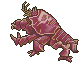

Now, back to your own drawing:

Create a new layer and copy-paste your drawing onto it. Click on the little padlock icon next to the original drawing layer. This prevents further changes to that layer. It's important to save that one in case something goes wrong later on, and you need to go back and copy/restore something from the original drawing.

Next, go to the layer with the fresh copy of your pixel drawing. To prepare it for animation, especially if its size is larger than 64 pixels, it's often an advantage to separate the creature into body parts. This way, you can use those as easy building blocks that you later copy-paste and move around without needing to mark, cut, paste, and redraw the same bunch of pixels over and over again.  
Use the polygonal lasso tool to select each body part, weapon, whatever, cut it, and then paste it into another new layer you've just created for that part. Name that layer something that matches the part you put there.  
Continue doing so until you have split everything into the parts you want. Remember that in pixel animation software like Aseprite the higher layers are displayed on top of the lower ones. So for example, if there is a hand in front of the body in your still image, then that hand should be cut and pasted into a layer above the layer of the body itself.

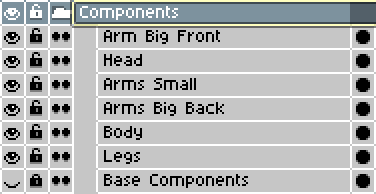

This is how I initially ended up organizing my Orgg drawing. Yours, of course, will look very different depending on the source material for your chosen creature.  
Note how I've also organized all of these layers into a combined group that I called 'Components'. This kind of grouping is very useful for keeping things organized as you move forward. You can do this by shift-clicking each layer you want to add and then right click and select the 'Add to Group' option. Then double-click the group folder to name it as you prefer.  
Now, with this done, you can simply click the eye or the lock icon on the group line to simultaneously toggle the display/hide and the lock/unlock status of all layers in the group. This will save you lots of clicks later.

Now it's time to check and prepare each layer. Select one layer at a time and hide all the other layers from view. You will see empty spaces where other body parts or items had been placed next to or in front of this section of the original image. Now draw pixels to try and fill out any missing areas the way you imagine they should look. This way you'll soon be able to copy-paste and shift each of these layers around without any voids immediately appearing underneath. This will also save you lots of time as you animate.

Here's how I've done it for two of the Orgg creature's body parts:

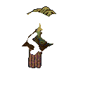 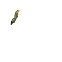

The torso and the one upper arm both had other parts positioned in front of them, so after cutting those parts into separate layers, I drew a bunch of pixels to fill in the gaps left behind. No external references used, just some quick freehand improvisation. These areas won't show for more than a split second at a time anyway, so no need for perfection.

### **3.8 Animation!** ###

Finally, we're ready to animate our creature. So far we've only assembled one image frame composed of layers of still images on top of each other. Now it's time to add the next dimension - a series of new image frames on which we will gradually change the posture of our first creature sprite. When these frames are played back in succession we'll have our animation effect.

Now add a bunch of new empty frames to the timeline window where you've previously made all the different image layers. In Aseprite you can do this by pressing ALT+N, or by clicking the + button in the lower right corner, or by right-clicking on the number 1 on top of your current frame column. As a starting point, go for something like 4 or 8 frames. A lot of existing Adventure Mode sprite sheets use these numbers of frames for the various creature animations. 4 frames are often enough for an Idle animation, whereas Walk and Attack typically benefit from having 8 frames to better show the larger range of motions. Of course, you can adjust these frame numbers along the way, depending on your choices of movement for your creature.

After this, double-click the numbers atop the frames and type 200 milliseconds into the Frame Properties prompt that pops up. This ensures that when you test the animations as you go along, the playback will happen at the same speed as it will inside the game.

Next, right-click the 'Components' group you made and select 'Duplicate'. Rename the duplicate group 'Idle'. After this, make sure that to delete any copy of the reference image or the first full pixel image you drew (the one not split into components) from the new Idle group. Then copy the new Idle group folder three more times to also create groups for Walk, Attack, and Death. Now you're all set.

Pick a movement category and begin to copy-paste the components from the first frame into the second one. Once there, you can move, transform, and adjust the pixels on each of the component layers you've previously prepared. Go back and forth between the frames to check how the animation looks and keep making adjustments until you're satisfied. When done on one frame, copy the contents of it onto the next frame and continue the process.

I like to first try and assemble a rough draft of the entire movement and then only later go back to finalize each frame. Below you can see such a first take I made for the Attack animation of the Orgg.

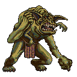

As you can see, turning/transforming motions tend to cause distortion of the affected area's pixel order. In contrast, with up/down/left/right moves you only need to fill in any missing pixels that may appear in the gaps between the moved components. The 8 frame animation shown here ended up being composed of 12 image layers, which is perhaps a bit on the high end for this sort of sprite animation work. But as you can see on the image below, I split some of the arms into three layers (upper arm, forearm, fist) to make the animation movements look more realistic. Also, I added two extra layers along the way, just so that parts of one of the Orgg's small arms could move in front of the creature's face on the last two frames.

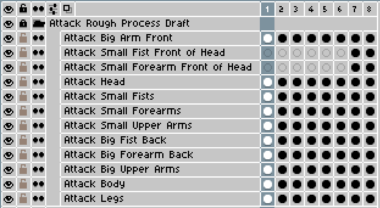

For your creature animations in the Walk and Idle categories, remember that those will play on loop inside Adventure Mode. This means that you should try and make sure that the last frame of your animation transitions smoothly back into the first one again. Otherwise, your creature's movements will look choppy inside the game.

Once you finish a full animation sequence, press the padlock icon to the left of the group. This protects the sequence from accidental changes as you move along.

After you've created and locked in all the animations that you want for your creature, create a duplicate of each of these animation groups. Press the eye icons to hide every layer from view across your whole project file. Then press the eye icon on one of your duplicated groups to make just that one visible again. Right click that group and select 'Flatten Visible'. This combines all the different layers of each frame into just one single one. Very conveniently, your animation now consists of just those 4-8 frames you need for that animation on the sprite sheet. Repeat this process for all the other duplicate animation groups you just made.

By only flattening a copy of each animation category you ensure that you'll still be able to go back later on and make changes to any individual layer, if the need arises.

Here are the completed Idle, Walk, Attack, and Death animations for the Orgg creature.

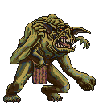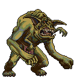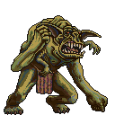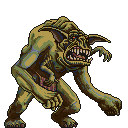

Lastly, create a single new single layer apart from all the others and name it 'Avatar'. The avatar images are the portraits that show on the screen while you battle the corresponding enemy in an MtG game. You'll need to include such a 16x16 pixel portrait image of your creature on its sprite sheet, and by doing it here you can experiment with different copy-pasted snapshots of the creature's face to see which one works best.

Here's the one I decided on for the Orgg:

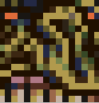

I kind of like the way the Adventure Mode game already does this sort of extreme close-up of some of the final castle bosses. It makes the creatures seem very big when the players battle them. So, I did the same here for the Orgg.

You can also at this point decide to draw an entirely new avatar portrait, perhaps in case the pixel resolution or features of your creature sprite's head or face don't work well in the form of a direct copy.

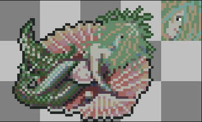

For example, all the hair in front of the face on this Seasinger sprite prevented me from getting a good 16x16 avatar out of a regular copy-pasted snapshot. Instead, I drew a separate slightly enhanced avatar portrait that included more of the face.

If your selected 16x16 avatar happens to fully match the same part on one of your other sprite frames, you can actually skip the creation of this separate avatar image. Instead, simply assign the appropriate coordinates to the avatar definition in your sprite sheet's accompanying .atlas file. More on that in the next subsection.

In Adventure Mode every enemy creature's sprite sheet needs to include such an avatar portrait, with its coordinates defined in the accompanying .atlas file. If you don't include this, the whole Adventure Mode game will simply crash to desktop whenever the player encounters your creature and an MtG battle is about to start. So, yeah…

### **3.9 Assembling Your New Sprite Sheet** ###

Time to assemble everything on a sprite sheet and prepare it for use in the game.

**The Sprite Sheet**

An easy way to prepare a sprite sheet is to create a new empty canvas in Aseprite. Then, one at a time, copy each assembled frame from your project file and paste it onto the new canvas. Match the size of the new canvas to the total dimensions of the sprites you want to include.

Say, you have a 64x64 pixel character with four different animation sequences, each composed of up to 8 frames. Then you likely need a canvas with a width of 512 pixels (8x64) and a height of 256 pixels (4x64). This allows you to assign each full series of animation frames to its own row. That's convenient for the overview and also matches the way it's already done for the other sprite sheets in the game. If an animation sequence contains less than 8 frames, you just leave the rest of that row empty.

If you've made a separate avatar portrait, remember to include a 16x16 pixel space for it somewhere on the sprite sheet. Either add another 16 pixels to the total height or width of the canvas, or simply place the avatar wherever there's extra space - for example at the end of a row with fewer animation frames than the others.

Once you've assembled your full sprite sheet, save it as a png file with the name of the creature. Note: use only lower-case letters for the name of the file. This keeps it aligned with the formatting of the other sprite sheets already used in Adventure Mode.

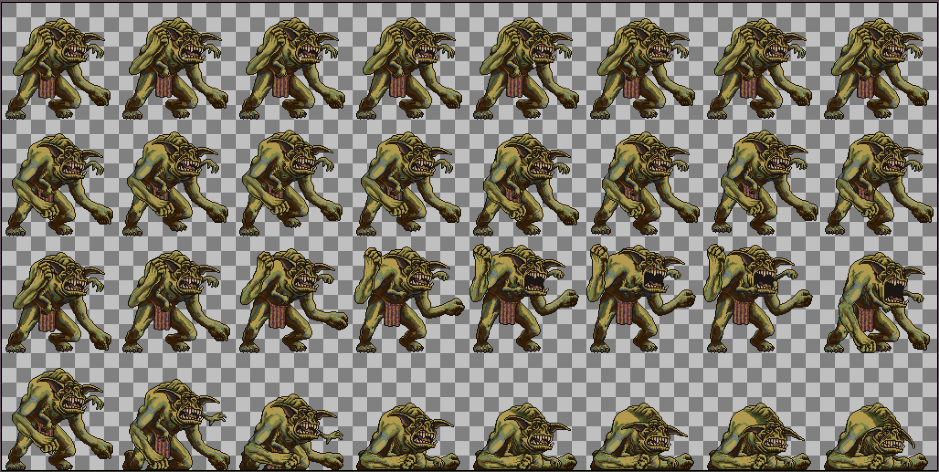

Here is the assembled sprite sheet for the Orgg creature. Total size 1024x512 pixels. On this sheet there is no need to include a separate 16x16 avatar picture, since the overall sprite resolution is high enough that one can be defined from a section of one of the faces.

**The Atlas File**

Atlas files tell the game how to interpret the contents of each sprite sheet. The file defines the size and coordinates of each animation frame on the sprite sheet, the positions of movement categories (e.g. Idle, Walk, etc.), and the sequential order of their display.

Atlas files are crucial for sprite sheets to work inside the game, and each sprite sheet .png file must have an accompanying .atlas file carrying the exact same name.

You can open and edit atlas files using Notepad or another basic text editor.

Inside you'll find a bunch of numbers and coordinates. Don't get overwhelmed by this. It's not nearly as complicated as it may look at first, and you'll quickly understand the logic behind.

The quickest way to set up a new atlas file is to first copy-paste an existing one from your local game installation folder (i.e. a subfolder of \\...\\res\\adventure\\common\\sprites). Rename the copied atlas file so that it matches the name of your own sprite sheet.

Next, you edit it. Inside the atlas file, first change the name on the top line so that it matches the exact name of your newly created sprite sheet png. On the second line, make sure that the size indication matches the total pixel resolution of your sprite sheet. The next three lines you can just ignore, as long as they state:

format: RGBA8888

filter: Nearest,Nearest

repeat: none

After this, you'll see a bunch of lines with words and numbers. For example, one of the first entries will likely say something like:

Idle

xy: 0, 0

size: 64, 64

By now the 'Idle' term should be very familiar to you, since it corresponds to the same animation category on your sprite sheet (i.e. Idle, Walk, Attack, Death, etc.).  
Underneath the 'Idle' word you'll see two lines; one line called 'xy', and the other called 'size'.

The **xy** numbers specify the exact coordinates of the first pixel in the upper left corner of each individual image frame. This info tells the game where it should start when rendering that sprite frame in the game. The numbers indicate how many pixels this spot is away from the starting zero point in the upper left corner of the sprite sheet.

The **size** numbers below tell the game how many pixels this particular sprite frame consists of. That is, starting from the xy coordinates, how many pixels should it render in left-to-right and up-to-down directions before the entire image is shown.

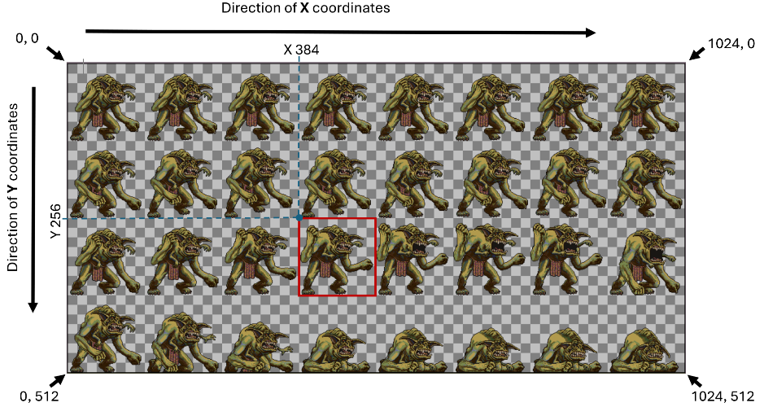

In the example picture above, the red square indicates the 128x128 size of one particular sprite frame.

The small blue dot in the upper left corner of the red square indicates the xy starting position for that frame.

In this example, the corresponding entry in the Orgg's atlas file is:

Attack

xy: 384, 256

size: 128, 128

Each animation frame requires its own entry in the atlas file. If you have 4 Idle frames on your sprite sheet, then you need to have 4 unique 'Idle' entries in the atlas file.

In the Orgg example above, the highlighted frame is number 4 out of 8 of the Attack animation. This means that the Orgg's atlas file must have 3 other 'Attack' entries listed before the one highlighted, and 4 more entries after it.

**Tip:** If you want a particular animation frame to stay visible for longer - for instance if you want your creature to stop and hold a particular pose for a moment - you can do this by copy-pasting the same entry several times in the atlas file. Each duplication adds 0.2 seconds to the time that the selected frame displays in the game.

In image editing software like Aseprite you can easily check the xy pixel coordinates as you move the cursor across an image. Down in the lower left corner of the program screen, the numbers on the left change all the time, matching your current cursor location. 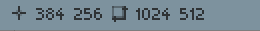

In general, though, setting up atlas files becomes trivially easy once you're familiar with the xy grid system. When you know the pixel size of your sprites and the layout of your sprite sheet, then filling out the xy coordinates becomes a simple matter of adding numbers together.

Lastly, if you've made a sprite sheet for an enemy creature, your atlas file also needs to specify the location of a 16x16 pixel avatar portrait for use in MtG duels (Note: for all hero characters, their avatar images are stored separately in a combined sprite sheet. This helps players browse smoothly through them all when creating a new player character).

In the atlas file for an enemy creature the Avatar specification is listed as the first xy entry, right after the headline info and right before any of the animation frame entries.

I haven't included any separate Avatar portrait on the Orgg sprite sheet shown above. Instead, the atlas file refers to a snapshot of a section of one Orgg's face. I've set the coordinates as follows:

Avatar

xy: 74, 34

size: 16, 16

Can you spot which of the creature images above these coordinates point to?  
…

…  
…

If you guessed the first Orgg image in the upper left corner, then you're now fully ready to set up your own atlas files.

## **Section 4:** ##

**How to Add Your New Sprite Sheet to the Game**

To add your new creature sprite to the game there are two different ways; locally on your own gaming device, or by submitting it to become part of the official game release.

### **4.1 Locally On Your Own Device** ###

_First of all: remember that any changes you make to your local game installation files will be automatically replaced the next time you update the game to its latest release._

_For this reason, make sure to_ **_back up all your original and edited game files elsewhere_**_, so that they won't be lost, and so that you can easily re-add them to the game after an update._

With that out of the way, here's the how-to:

In your local game installation, the most straightforward way is to simply have your new sprite sheet replace the one used by another existing enemy.

Save a copy of your new sprite sheet + atlas file in the same folder as the one with the sheet you decide to replace. Delete the two old files and make sure that both of your new files carry the exact same name as the files they replace.

Next (optionally), go to the 'world' folder that matches the Adventure Mode world you're currently playing in (for instance 'common' for the standard world, or 'Realm of Legends' for the commander world). There, use Notepad or another simple text editor to open up the .json file named 'enemies'. Locate the entry for the creature whose sprite sheet you've replaced. There, right after the "sprite" category's link to the creature's .atlas file and right before the "deck" category, add a new line that says \["scale": 0.3,\]. Then save and exit.

If you made your new sprite at 64x64 pixels, then this will ensure that it will show up in the game at approximately the same size as the old one did. You can of course go back and forth to change this number as you like.

Now, inside your game you can either wait for the particular enemy creature to show up, or, you can speed things up to test it. Press F9 (or tap and hold your character portrait if on mobile) to open up the console. There, type "spawn enemy &lt;name of the creature&gt;" which will spawn a copy of that creature onto the map.

If you want your new creature sprite to be used by a unique creature not currently in the game, then things get a bit more complicated. This is because each unique creature requires other components apart from its own sprite sheet.

1. First, you need to create a deck for it to play. In your game installation folder, go to the 'decks' subfolder in the appropriate Adventure Mode world. There, copy one of the existing .DCK files and rename it to match the name of your new creature. Then open the file with Notepad or similar and change the deck name and decklist to match the cards you want it to include. Be very careful to ensure that the set code after each card name matches that of an expansion set the card was printed in (for instance, "Island|3ED"). You can find the set codes for each card by looking up the card on Scryfall.
2. Go to the 'enemies.json' file in the 'world' folder of your selected Adventure Mode world. There, copy the full entry for one of the existing creatures and paste it below. Edit the copied entry so that it contains the name of your new creature, along with the links to the sprite sheet and the deck file you created for it. Also, edit the parameters below to match the spawn rate, life, speed, reward, etc. that you want your creature to have. Remember to set a number higher than 0 for the spawn rate, or else the creature will never randomly appear in the game. Also, remember to update the entry for the biomes in which you want your creature to appear.

At this point, your unique creature should now be ready to spawn randomly in your locally installed game.

Additional note: After the steps above, if you want your creature to always show up in a particular position on a particular dungeon map, then you'll need to edit the .tmx file for that map (found within the 'maps' subfolder of your selected Adventure Mode world's folder). If you just want it to replace another creature already there, you can simply open up the .tmx file in Notepad, locate the name of the creature, and then replace that name with the name of yours.  
 If you want your creature to show up in a different location on the map, or if you want to create a new map, you'll need to use software better suited for the task. This could for instance be a program like Tiled. You can go to this part of the tutorial for Forge on GitHub for a how-to on this (<https://github.com/Card-Forge/forge/wiki/Tutorial-1-Create-your-First-Plane> ).

### **4.2 As Part of the Official Release** ###

If you want your new creature sprite to become part of all official future releases of the game, then it needs to be submitted for inclusion in the master repository of Forge on GitHub (<https://github.com/Card-Forge/forge>).

The most direct way to submit your own sprite sheet is to make a pull request on the Card-Forge repository on GitHub. This is the best way if you plan on contributing with multiple sprite sheets or other contributions over time. To get started on this, check out this page on the Forge Wiki: <https://github.com/Card-Forge/forge/wiki/Modding>.

If you don't feel particularly tech-savvy, or if you'd like to get creative feedback or help with the submission process, you can go to the Discord server of Forge (<https://discord.com/invite/3v9JCVr> ). There, you can post your sprite sheet and atlas file in one of the subchannels like #images or #adventurers-guild, along with any questions you may have. The Forge Discord community is quite large and very active, so other content creators and developers will be ready to provide you with feedback and guide you on the submission process. You can of course also share your current work-in-progress sprite on the Discord to get feedback on any part of the creation process. 

After your sprite sheet and atlas file have been submitted via a pull request, a developer will check the files and, if approved, add them to the next daily snapshot release of the game.

After this, if your creature sprite is based on a specific legendary MtG creature, then it will likely soon be added to the Realm of Legends world. There it will be used as the standard sprite for that particular legend, provided that another better matching sprite isn't used already.

If your creature sprite is based on another non-legendary existing MtG creature card, or if your sprite is a generic creature sprite, then it will be added to the common creature sprite folder of the game. In this case the creature sprite will only show up in the game once a content creator uses it for a creature on a dungeon/cave map or as a randomly spawning creature on the overworld map. If you want, YOU can also be that content creator; see (<https://github.com/Card-Forge/forge/wiki/Modding> ) for how to get started on this.  

  **Please note the following submission rules for sharing your sprites for use in Forge:**

In order for a creature sprite to be considered for inclusion in Forge Adventure Mode, the following conditions need to be in order:

\- Forge is a full non-commercial software developed by a community of volunteers. Nobody gets paid for their contributions. The same is true for all sprite sheets contributed to the game.  

\- All sprites must be submitted by the person who made them, and all sprites must be open source. By submitting your own sprite creations for inclusion in Forge you consent to making your creations open source and freely available for all others to use.

\- All sprites must either be new original creations or reworked (e.g. recolored or edited) versions of existing open source sprites.

\- The sprites can be inspired by specific MtG artworks, but they shouldn't be visually close copies to the point where they might infringe on image copyrights.

\- The sprites must fit within the size range allowed for Adventure Mode. This is between 16x16 and 128x128 pixels for each individual frame.

\- The sprite sheets must be submitted together with a matching .atlas file of the same name.

\- The sprite sheets must include animation frames in both the 'Idle' and 'Walk' categories. Exemption from the 'Walk' requirement can be made in cases where the creature sprite is obviously meant to be immobile (for instance, if it depicts a wall creature or a plant). The inclusion of animations in the 'Attack' and 'Death' categories are highly encouraged but not strictly required. Animations in any of the other supported categories are optional but always appreciated.

\- Each sprite submission must have a 16x16 pixel avatar image location defined in the .atlas file.

\- Each sprite must look visually appropriate for the MtG game (i.e. no excessively violent or sexualized imagery).

\- The visual style of the submitted creature sprites must be overall compatible with the style already used in Adventure Mode.