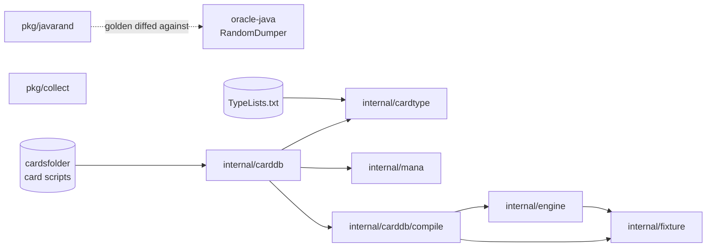

# Module Map

- **Status:** Active
- **Describes:** state as of 2026-09-13

Every Go package under `crucible/` gets a row here in the same commit that creates it (DOC-12).
[`crucible/tools/docgate`](../../../crucible/tools/docgate) fails the build on a package with no row, on a row pointing
at a directory that does not exist, and on a ported package whose row links to no port-log note.

Column meaning:

- **Package** — import path under `crucible/`.
- **Responsibility** — one line. If it needs two, the package is doing two things.
- **Java provenance** — the source it reproduces, or `—` for new code.
- **Port log** — note under [`../porting/port-log/`](../porting/port-log/), required for ported units (PORT-4). This
  column is the index of those notes; there is no second list.

## Packages

| Package                                                                | Responsibility                                                                                                                                                                                                            | Java provenance                                                                                                                                                                        | Port log                                                                                                         |
| ---------------------------------------------------------------------- | ------------------------------------------------------------------------------------------------------------------------------------------------------------------------------------------------------------------------- | -------------------------------------------------------------------------------------------------------------------------------------------------------------------------------------- | ---------------------------------------------------------------------------------------------------------------- |
| [`pkg/collect`](../../../crucible/pkg/collect)                         | Insertion-ordered set, because iteration order is load-bearing for trigger ordering                                                                                                                                       | Guava-backed `FCollection`, used throughout `forge-game`                                                                                                                               | — new code, not a line port                                                                                      |
| [`pkg/javarand`](../../../crucible/pkg/javarand)                       | Bit-exact `java.util.Random`, for differential testing only                                                                                                                                                               | `java.util.Random`, `Collections.shuffle`, `MyRandom.percentTrue`                                                                                                                      | — algorithm is specified by javadoc, not read from Forge                                                         |
| [`internal/carddb`](../../../crucible/internal/carddb)                 | Card scripts to `Card`: faces, keys, ability lines kept as text                                                                                                                                                           | `forge.card.CardRules` and its `Reader`, `CardFace`, `CardSplitType`                                                                                                                   | [`card-rules-reader.md`](../porting/port-log/card-rules-reader.md)                                               |
| [`internal/carddb/compile`](../../../crucible/internal/carddb/compile) | Ability lines to a tree: record type, API, params, and `SubAbility$` chains resolved into direct references                                                                                                               | `forge.game.ability.AbilityFactory` (`getAbility`, `getSubAbility`)                                                                                                                    | [`ability-factory.md`](../porting/port-log/ability-factory.md)                                                   |
| [`internal/carddb/vocab`](../../../crucible/internal/carddb/vocab)     | Measures the script vocabulary: every param key, API, mode, count head, cost part, valid token and keyword head the corpus uses                                                                                           | `AbilityFactory.getMapParams`, `AbilityUtils`, `CardProperty`, the `cost/` package                                                                                                     | — new code; measures the Java grammars rather than porting one                                                   |
| [`internal/deck`](../../../crucible/internal/deck)                     | `.dck` decklists: sections and card entries, as written                                                                                                                                                                   | `forge.deck.DeckSection`, `Deck.loadDeckSections`, `CardPool.processCardList`                                                                                                          | [`deck-serializer.md`](../porting/port-log/deck-serializer.md)                                                   |
| [`internal/cost`](../../../crucible/internal/cost)                     | Cost strings: what a player pays to activate an ability or cast a spell                                                                                                                                                   | `forge.game.cost.Cost` (its constructor and `parseCostPart`)                                                                                                                           | [`cost-strings.md`](../porting/port-log/cost-strings.md)                                                         |
| [`internal/expr`](../../../crucible/internal/expr)                     | Amount expressions: the numbers an ability computes rather than states                                                                                                                                                    | `forge.game.ability.AbilityUtils` (`calculateAmount`, `doXMath`)                                                                                                                       | [`count-expressions.md`](../porting/port-log/count-expressions.md)                                               |
| [`internal/engine`](../../../crucible/internal/engine)                 | The rules core: the arena every handle indexes into, cards and their parts, players, zones, effect dispatch, the controller interface, state-based actions, turn structure, mulligans, the stack, valid-string evaluation | `forge.game.Game`, `Card`, `Player`, `zone.Zone`, `zone.ZoneType`, `zone.MagicStack`, `player.PlayerController`, `GameAction`, `phase.PhaseHandler`, `mulligan.*`, `card.CardProperty` | [`game-state.md`](../porting/port-log/game-state.md), [`valid-strings.md`](../porting/port-log/valid-strings.md) |
| [`internal/fixture`](../../../crucible/internal/fixture)               | Forge's `GameState` text format: parses it, builds a `*engine.Game` from it, writes one back, and runs a scenario's `actions.log` against it                                                                              | `forge.game.GameState` (`parse`, `processCardsForZone`, `applyGameOnThread`, `toString`)                                                                                               | [`game-state-fixture.md`](../porting/port-log/game-state-fixture.md)                                             |
| [`internal/smoke`](../../../crucible/internal/smoke)                   | Plays one card at a time through a fixed two-player board with a default-answer controller and reports what the engine refuses, per cause; the measure of "how many cards play" (ADR-0011)                                | — new code                                                                                                                                                                             | [`smoke-probe.md`](../porting/port-log/smoke-probe.md)                                                           |
| [`internal/valid`](../../../crucible/internal/valid)                   | Valid strings: the predicates deciding what an ability may target, affect or count                                                                                                                                        | `forge.game.card.CardProperty`, `forge.util.Expressions`                                                                                                                               | [`valid-strings.md`](../porting/port-log/valid-strings.md)                                                       |
| [`internal/keyword`](../../../crucible/internal/keyword)               | `K:` lines: the head, its positional details, and the enum entry saying how they are shaped                                                                                                                               | `forge.game.keyword.Keyword` and its `KeywordInstance` subclasses                                                                                                                      | [`keywords.md`](../porting/port-log/keywords.md)                                                                 |
| [`internal/mana`](../../../crucible/internal/mana)                     | Mana costs: colours, shards, and the `ManaCost` line every card script carries                                                                                                                                            | `forge.card.mana.ManaCost`, `ManaCostShard`, `ManaCostParser`, `ManaAtom`, `MagicColor`                                                                                                | [`mana-cost.md`](../porting/port-log/mana-cost.md)                                                               |
| [`internal/cardtype`](../../../crucible/internal/cardtype)             | Type lines, and the subtype vocabulary they are checked against                                                                                                                                                           | `forge.card.CardType`, its `Helper.parseTypes`, and `FModel.loadDynamicGamedata`                                                                                                       | [`card-type.md`](../porting/port-log/card-type.md)                                                               |
| [`cmd/crucible`](../../../crucible/cmd/crucible)                       | The CLI: `corpus-coverage` (which card names the database lacks) and `card-smoke` (which cards the engine plays, via `internal/smoke`)                                                                                    | — new code                                                                                                                                                                             | —                                                                                                                |
| [`tools/carddump`](../../../crucible/tools/carddump)                   | Writes the whole corpus as canonical JSON, for the P1 diff against Forge's reader                                                                                                                                         | — new code                                                                                                                                                                             | —                                                                                                                |
| [`tools/vocabscan`](../../../crucible/tools/vocabscan)                 | Prints that vocabulary, and generates `porting/parity-matrix.md` from it and the effect registry                                                                                                                          | — new code                                                                                                                                                                             | —                                                                                                                |
| [`tools/covergate`](../../../crucible/tools/covergate)                 | Fails the build on a package below the coverage floor TEST-12 declares for it                                                                                                                                             | — new code                                                                                                                                                                             | —                                                                                                                |
| [`tools/docgate`](../../../crucible/tools/docgate)                     | Fails the build on code that landed without its documentation                                                                                                                                                             | — new code                                                                                                                                                                             | —                                                                                                                |
| [`tools/enginelint`](../../../crucible/tools/enginelint)               | Enforces file-group boundaries inside the single `internal/engine` package                                                                                                                                                | — new code; exists because Go has no sub-package visibility                                                                                                                            | —                                                                                                                |
| [`tools/javacycles`](../../../crucible/tools/javacycles)               | Reproduces ADR-0003's Java package-cycle count                                                                                                                                                                            | — new code                                                                                                                                                                             | —                                                                                                                |
| [`tools/apiscan`](../../../crucible/tools/apiscan)                     | Recovers each ability API's param vocabulary from Forge's call sites, and fails the build on a param key nothing reads                                                                                                    | — new code                                                                                                                                                                             | —                                                                                                                |
| [`tools/genparams`](../../../crucible/tools/genparams)                 | Generates the typed parameter struct for every ability API from that scan's evidence table                                                                                                                                | — new code                                                                                                                                                                             | —                                                                                                                |
| [`tools/genapitype`](../../../crucible/tools/genapitype)               | Generates the `APIType` constants from Forge's `ApiType` enum                                                                                                                                                             | — new code                                                                                                                                                                             | —                                                                                                                |
| [`tools/genregistry`](../../../crucible/tools/genregistry)             | Generates `internal/engine`'s `NewRegistry` (`registry_gen.go`) from the package's `*Effect` types; `-check` fails on a stale file or a wrong resolved-API count in the docs (ADR-0017)                                   | — new code                                                                                                                                                                             | —                                                                                                                |
| [`tools/landporter`](../../../crucible/tools/landporter)               | Lands a worktree porter's branch: merge, remeasure `card-smoke`, rewrite every doc that quotes the measurement, docs commit, cleanup                                                                                      | — new code                                                                                                                                                                             | —                                                                                                                |

**Twenty-five packages: two in `pkg/`, twelve in `internal/`, one `cmd/`, ten in `tools/`.** The split follows
[ADR-0003](../adr/0003-go-project-layout.md): `pkg/` is reserved for code with no Crucible semantics, and an ordered set
and a generator port qualify; `tools/` holds build-time commands the engine never imports; everything with rules
meaning, `mana` and `cardtype` included, goes in `internal/` where nothing outside the module can import it.

## Not Go, but built here

| Path                                            | Purpose                                                                                                                                                                            |
| ----------------------------------------------- | ---------------------------------------------------------------------------------------------------------------------------------------------------------------------------------- |
| [`oracle-java/`](../../../crucible/oracle-java) | Differential-testing oracle. Standalone Maven module, JDK-only today. Never shipped, never on Crucible's execution path ([ADR-0010](../adr/0010-differential-testing-strategy.md)) |

## Enforcement

| Tool                                                       | Scope                | Enforces                                                                                                                                                       |
| ---------------------------------------------------------- | -------------------- | -------------------------------------------------------------------------------------------------------------------------------------------------------------- |
| `depguard`, inside `golangci-lint`                         | Between packages     | ADR-0002 stdlib-only runtime, ADR-0006 no global RNG, ADR-0003 arrow direction                                                                                 |
| [`tools/enginelint`](../../../crucible/tools/enginelint)   | Inside one package   | File-group boundaries within `internal/engine`, which no package-level tool can see; effect files declare their own group with `//enginelint:allow` (ADR-0017) |
| [`tools/genregistry`](../../../crucible/tools/genregistry) | Effect wiring        | ADR-0017: `registry_gen.go` matches the effect files; docs quote the registered count                                                                          |
| [`tools/javacycles`](../../../crucible/tools/javacycles)   | The Java tree        | Re-checks ADR-0003's cycle premise (87 cycles) after an upstream sync                                                                                          |
| [`tools/docgate`](../../../crucible/tools/docgate)         | Code against docs    | DOC-12 module-map rows, PORT-4 port-log notes, ADRP-4 ADR-before-code                                                                                          |
| [`tools/covergate`](../../../crucible/tools/covergate)     | Tests against docs   | TEST-12 coverage floors, read from the guideline rather than a second config                                                                                   |
| [`tools/carddump`](../../../crucible/tools/carddump)       | Go against Java      | P1: every card's canonical JSON, diffed against `oracle-java`'s `CardRulesDumper`                                                                              |
| [`tools/apiscan`](../../../crucible/tools/apiscan)         | Scripts against Java | P2: no card writes a param key no Java code reads, outside the parity-matrix allowlist                                                                         |

## What the arrows look like today

`internal/carddb` turns a card script into a value, drawing on `internal/mana` and `internal/cardtype`.
`internal/engine` is the one-way arrow ADR-0003 describes: it imports `internal/carddb/compile` for the shared,
immutable card database every game runs against, and nothing imports back into it. `internal/fixture` sits above both:
it builds an `*engine.Game` from a fixture's text, so it needs `compile.DB` the same way the engine's own callers will
once something loads a real corpus rather than a test's three named cards.

## Planned, not built

Listed so the gap between this map and [ADR-0003](../adr/0003-go-project-layout.md)'s layout is visible rather than
inferred. Each lands with its milestone (ARCH-2).

| Package                                                | Milestone |
| ------------------------------------------------------ | --------- |
| `internal/valid`, `internal/expr`                      | M6        |
| `internal/ai`                                          | M7        |
| `internal/sim`, `internal/telemetry`, `internal/store` | M8        |
| `internal/report`, `cmd/crucible`                      | M9        |

## Invalidated by

- Any new package under `crucible/` — the row is required in the same commit
- The first `internal/` package, which makes the "nothing imports anything" statement wrong
